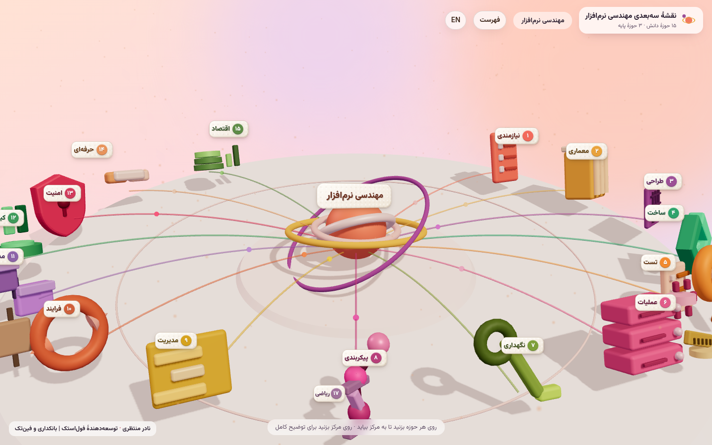
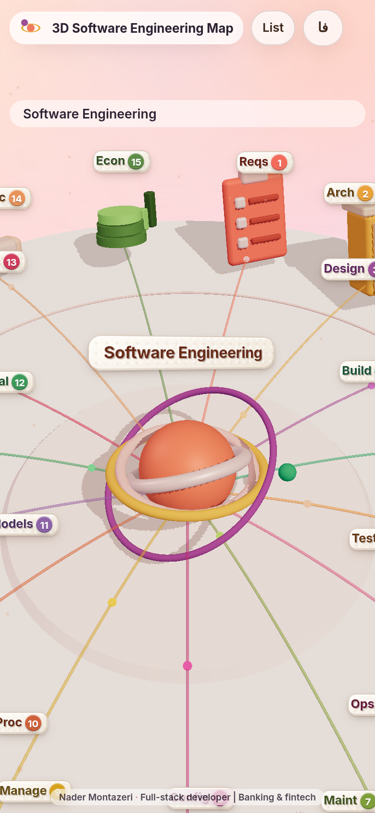

# SWEBOK 3D Map

Interactive 3D learning map of the **Software Engineering Body of Knowledge** — browse knowledge areas, open topics, and tap glossary terms for mini-lessons. Available in **Persian (FA)** and **English (EN)**.

**Live demos**

- Persian: [https://nmontazeri.meetver.com/swebok/](https://nmontazeri.meetver.com/swebok/)
- English: [https://nmontazeri.meetver.com/swebok/en/](https://nmontazeri.meetver.com/swebok/en/)



*Mobile view:*



## What it is

A browser-based Three.js scene that lays out software-engineering knowledge areas as tappable 3D plaques. Selecting an area brings it to the center, reveals its topics, and opens an educational panel. Colored terms open a glossary sheet with definition, how-it-works notes, examples, and short practice items. UI language switches between FA and EN without a reload.

Content is an educational paraphrase organized around common software-engineering knowledge areas and foundations (requirements, architecture, design, construction, testing, operations, maintenance, configuration, management, process, models and methods, quality, security, professional practice, economics, plus computing / mathematical / engineering foundations). It is not an official publication of any standards body.

## Tech stack

- **Three.js** (r170) — WebGL scene
- **CSS2DRenderer** — HTML plaques in 3D space
- **esbuild** — bundles `src/main.js` (+ icons / plaques) into `assets/app.js`
- Static HTML/CSS, self-hosted Inter + Vazirmatn fonts

## Project layout

```
src/                 Application source (main.js, plaques.js, icons.js)
src/data/            Knowledge-area and glossary content (FA + EN)
assets/              Runtime assets (style, fonts, built app.js & data.js)
en/                  English entry redirect
build/build.sh       Build script
docs/                Built static copy + screenshots (Pages-ready)
```

## Build and run locally

Requires Node.js 18+.

```bash
npm install
npm run build
npx --yes serve -l 4173 .
# open http://localhost:4173/
# English: http://localhost:4173/en/  or  http://localhost:4173/?lang=en
```

`npm run build` concatenates `src/data/*.js` into `assets/data.js`, bundles the app with esbuild into `assets/app.js`, and syncs a ready-to-serve tree into `docs/`.

## License

MIT © 2026 Nader Montazeri — see [LICENSE](LICENSE).

---

## فارسی

نقشهٔ آموزشی سه‌بعدی و تعاملی برای مرور پیکرهٔ دانش مهندسی نرم‌افزار: حوزه‌های دانش، سرفصل‌ها، و واژه‌نامهٔ لمسی با درس‌های کوتاه. رابط کاربری **فارسی** و **انگلیسی**.

**نسخهٔ زنده**

- فارسی: [https://nmontazeri.meetver.com/swebok/](https://nmontazeri.meetver.com/swebok/)
- انگلیسی: [https://nmontazeri.meetver.com/swebok/en/](https://nmontazeri.meetver.com/swebok/en/)

### چیست؟

یک صحنهٔ Three.js در مرورگر که حوزه‌های دانش را به‌صورت پلاک‌های سه‌بعدی قابل‌لمس نشان می‌دهد. با انتخاب هر حوزه، به مرکز می‌آید، سرفصل‌ها دیده می‌شوند و پنل آموزشی باز می‌شود. روی واژه‌های رنگی بزنید تا تعریف، نحوهٔ کار، مثال و تمرین کوتاه را ببینید. زبان رابط بدون بارگذاری مجدد عوض می‌شود.

محتوا بازنویسی آموزشی حول حوزه‌های رایج دانش مهندسی نرم‌افزار است و انتشار رسمی هیچ نهاد استانداردی نیست.

### پشتهٔ فنی

Three.js، CSS2D، esbuild، HTML/CSS ایستا، فونت‌های Inter و وزیرمتن.

### ساخت و اجرا

```bash
npm install
npm run build
npx --yes serve -l 4173 .
```

### مجوز

MIT © ۲۰۲۶ نادر منتظری — پروندهٔ [LICENSE](LICENSE).
